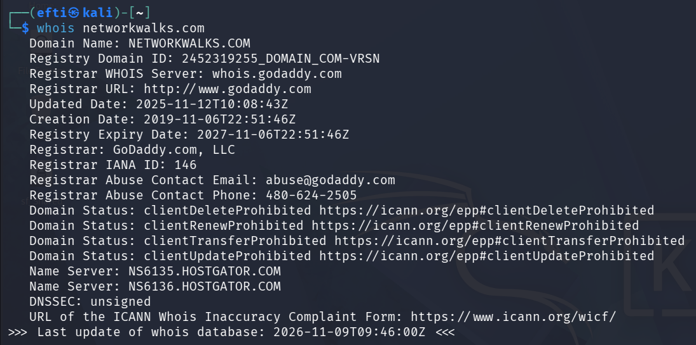
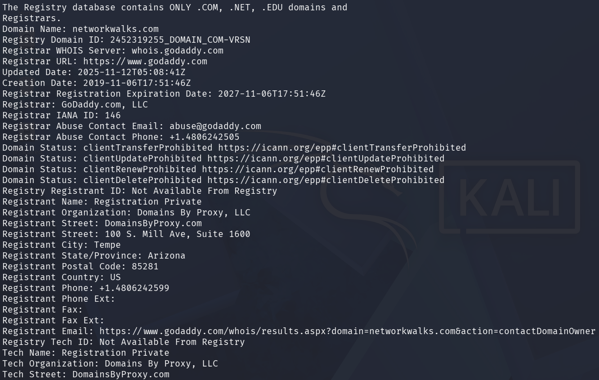
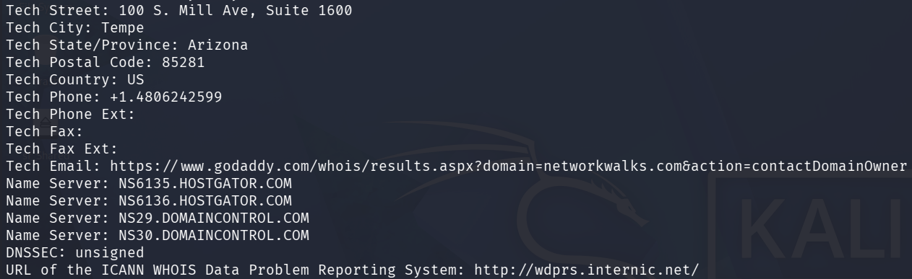
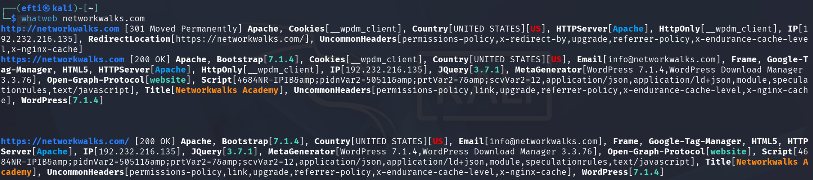
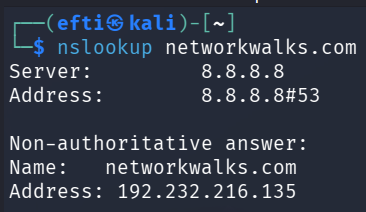
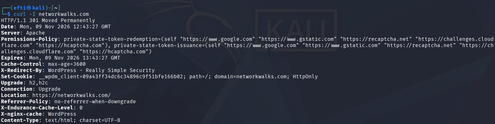
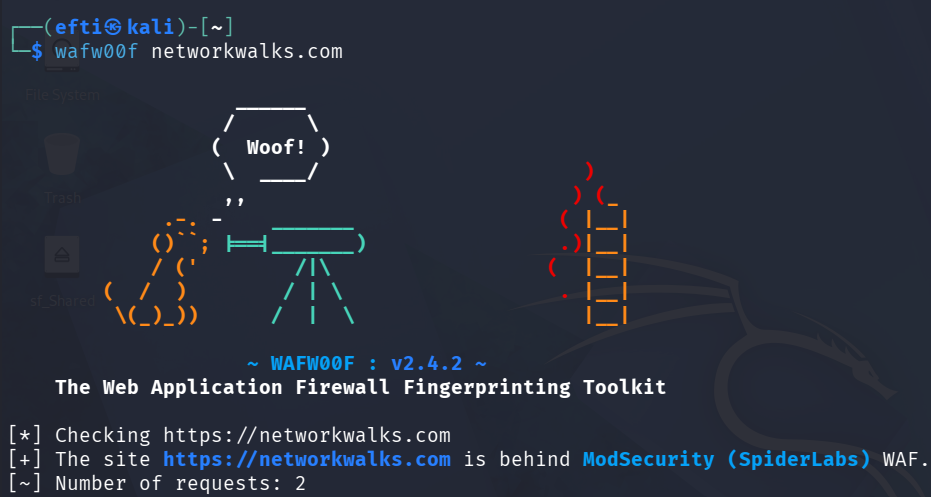
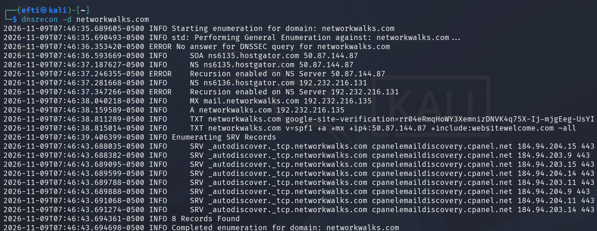
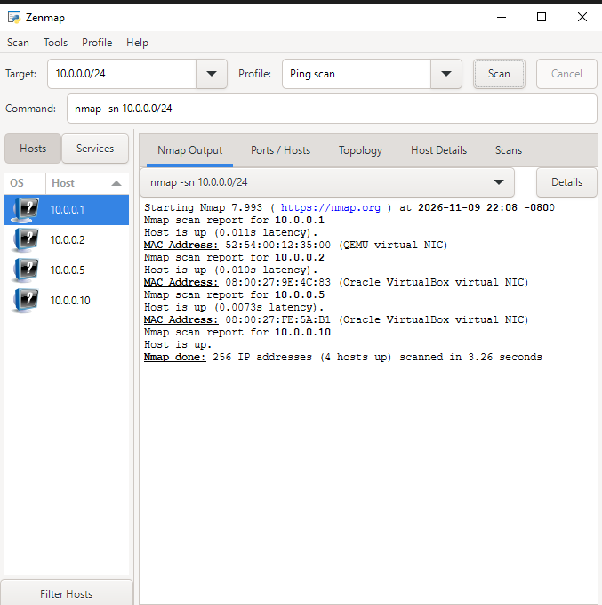
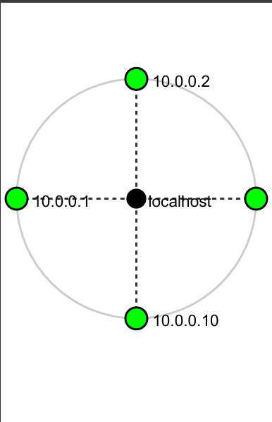

# Week 02 – Footprinting, Reconnaissance & Network Scanning

A practical cybersecurity lab completed as part of the **Networkwalks Cybersecurity Program (Batch B084)**. This week focused on collecting publicly available information about a domain and discovering active devices on a private lab network.

> **Author:** Md. Sibgatur Rahman Efti  
> **Program:** Networkwalks – Cybersecurity Program, B084  
> **Report date:** 09 November 2026  
> **Modules:** W2-PM1 (Multiple Kali Tools) and W2-PM5 (Zenmap Scanning)

---

## 1. Project Overview

This project covers two practical activities:

1. **Footprinting and reconnaissance:** Used Kali Linux tools to collect domain registration details, identify web technologies, inspect HTTP headers, detect the Web Application Firewall (WAF), and enumerate DNS records for `networkwalks.com`.
2. **Network discovery:** Used Zenmap (Nmap GUI) to perform a ping scan of the private lab subnet `10.0.0.0/24` and identify live hosts.

The exercises demonstrate how information gathering can help a security analyst understand a target's publicly visible infrastructure and map devices within an authorized local network.

## 2. Scope and Authorization

| Activity | Target | Scope |
|---|---|---|
| Domain footprinting | `networkwalks.com` | Public information gathering; written permission was secured as stated in the project report |
| Network discovery | `10.0.0.0/24` | Own local lab network |

All activities were conducted for educational purposes and within the authorized scope. No exploitation or vulnerability validation was performed.

## 3. Tools Used

| Tool | Purpose |
|---|---|
| Kali Linux | Environment for reconnaissance tools |
| `whois` | Retrieve domain registrar, registration dates, status and name-server information |
| `whatweb` | Identify web technologies, CMS, server and related details |
| `nslookup` | Resolve a domain name to an IP address using DNS |
| `curl -I` | Inspect HTTP response headers without downloading the page body |
| `wafw00f` | Fingerprint the Web Application Firewall protecting a website |
| `dnsrecon` | Enumerate DNS records such as SOA, NS, MX, A, TXT and SRV |
| Zenmap / Nmap | Discover live hosts on the local subnet |

## 4. Practical Activities

### 4.1 WHOIS – Domain Registration Lookup

**Command**

```bash
whois networkwalks.com
```

**Observations**

- Registrar: GoDaddy.com, LLC.
- Creation date: 06 November 2019.
- Registry expiry date: 06 November 2027.
- The WHOIS output lists HostGator and DomainControl name servers.
- DNSSEC status: unsigned.
- Registrant information is privacy-protected through Domains By Proxy, LLC.
- Client delete, renew, transfer and update prohibition statuses are present.

WHOIS information helps identify the registrar, domain lifecycle details and DNS infrastructure. Privacy protection limits the personal registrant information visible in the public record.

**Evidence**



*Figure 1 – WHOIS domain registration output.*



*Figure 2 – WHOIS registrant and technical contact details, with privacy protection.*



*Figure 3 – WHOIS name-server and DNSSEC information.*

### 4.2 WhatWeb – Web Technology Fingerprinting

**Command**

```bash
whatweb networkwalks.com
```

**Observations**

- HTTP redirects to HTTPS with status `301 Moved Permanently`.
- The HTTPS endpoint returned `200 OK` during the test.
- Detected web server: Apache.
- Detected CMS: WordPress 7.1.4.
- Detected WordPress Download Manager: 3.3.76.
- Detected jQuery: 3.7.1.
- Other identified technologies included Bootstrap 7.1.4, HTML5 and Google Tag Manager.
- Resolved IP shown by the tool: `192.232.216.135`.

Technology fingerprinting gives an initial view of the software exposed by a website. Version information should be checked against reliable vendor advisories before treating it as a security issue.

**Evidence**



*Figure 4 – WhatWeb output showing the detected web technologies.*

### 4.3 Nslookup – DNS Resolution

**Command**

```bash
nslookup networkwalks.com
```

**Observations**

- DNS resolver used: `8.8.8.8`.
- `networkwalks.com` resolved to `192.232.216.135`.
- The response was marked as non-authoritative.

A non-authoritative answer means the response came from a recursive resolver's DNS information rather than directly from the domain's authoritative name server.

**Evidence**



*Figure 5 – Nslookup resolving the domain to its IPv4 address.*

### 4.4 Curl – HTTP Response Headers

**Command**

```bash
curl -I networkwalks.com
```

**Observations**

- HTTP response: `301 Moved Permanently`.
- Redirect destination: `https://networkwalks.com/`.
- Server header: Apache.
- `X-Redirect-By` identifies WordPress – Really Simple Security.
- Cache-related headers include `X-nginx-cache` and `X-Endurance-Cache-Level`.
- `Permissions-Policy` and `Referrer-Policy` headers were present.

HTTP headers can disclose server and application details. Their presence alone does not confirm a vulnerability; configuration and behaviour need further review.

**Evidence**



*Figure 6 – HTTP response headers returned by the target.*

### 4.5 Wafw00f – WAF Fingerprinting

**Command**

```bash
wafw00f networkwalks.com
```

**Observations**

- Wafw00f version: 2.4.2.
- The tool identified **ModSecurity (SpiderLabs)** as the WAF.
- The detection was made using two requests.

WAF fingerprinting helps understand what type of filtering technology may be protecting a web application. This result identifies the reported WAF product, not its complete rule set or effectiveness.

**Evidence**



*Figure 7 – Wafw00f detecting ModSecurity (SpiderLabs).* 

### 4.6 DNSRecon – DNS Record Enumeration

**Command**

```bash
dnsrecon -d networkwalks.com
```

**Key observations from the run**

| Record / Detail | Observed result |
|---|---|
| SOA | `ns6135.hostgator.com` – `50.87.144.87` |
| NS | `ns6135.hostgator.com` and `ns6136.hostgator.com` |
| A | `networkwalks.com` – `192.232.216.135` |
| MX | `mail.networkwalks.com` – `192.232.216.135` |
| TXT | Google site-verification record and SPF record |
| SPF | Policy ends with `~all` (soft fail) |
| SRV | 8 cPanel email autodiscovery records were reported |
| DNSSEC | The DNSSEC query did not return an answer; WHOIS also reported DNSSEC as unsigned |

DNSRecon also reported recursion enabled on the two name servers it tested. This is a point for further verification: the scan output alone does not prove that either server is an openly accessible recursive resolver or that it can be abused for amplification.

**Evidence**



*Figure 8 – DNSRecon output showing the discovered DNS records and reported conditions.*

### 4.7 Zenmap – Local Network Discovery

**Target subnet**

```text
10.0.0.0/24
```

**Nmap command**

```bash
nmap -sn 10.0.0.0/24
```

The Zenmap **Ping scan** profile was used. The scan checked 256 addresses and reported **4 hosts up** in approximately **3.26 seconds**.

| IP address | MAC address | Vendor / observation | Reported latency |
|---|---|---|---:|
| `10.0.0.1` | `52:54:00:12:35:00` | QEMU virtual NIC | 0.011 s |
| `10.0.0.2` | `08:00:27:9E:4C:83` | Oracle VirtualBox virtual NIC | 0.010 s |
| `10.0.0.5` | `08:00:27:FE:5A:B1` | Oracle VirtualBox virtual NIC | 0.0073 s |
| `10.0.0.10` | Not shown in the scan output | Scanning machine itself, as described in the report | Not shown |

The MAC vendor information indicates that the discovered lab environment includes virtual network interfaces. The topology view also shows the scanning machine and discovered hosts. The label for the right-side node is cut off in the supplied topology screenshot; the report identifies that node as `10.0.0.5` based on the scan results.

**Evidence – Host discovery**



*Figure 9 – Zenmap ping scan of `10.0.0.0/24`, showing four live hosts.*

**Evidence – Network topology**



*Figure 10 – Zenmap topology view of the local lab network.*

## 5. Summary of Findings and Risk Notes

The following are information-disclosure and configuration observations from the exercises. They are not confirmed vulnerabilities.

| # | Finding | Potential concern | Report risk level |
|---:|---|---|---|
| 1 | Web technology and version information exposed | May help an attacker identify software to investigate | Medium |
| 2 | Public server IP identifiable | Helps map the web and mail service infrastructure | Low |
| 3 | HTTP technical and cache information exposed | May support further technology fingerprinting | Low |
| 4 | WAF technology identifiable | Reveals part of the web security setup | Low |
| 5 | DNS recursion reported as enabled | Could require review for unintended recursive access and abuse risk | Medium |
| 6 | DNS, mail and SPF details exposed; DNSSEC unsigned | Provides infrastructure details; email and DNS configuration should be reviewed | Medium |
| 7 | Domain registrant details protected by a privacy proxy | Privacy protection is present; registrar and name-server details remain public | Low |
| 8 | Four live hosts found on the local subnet | Unknown devices should be identified and authorised | Medium |

**Assessment limitation:** The activities covered passive/public footprinting and host discovery. No exploitation, authenticated testing, or vulnerability validation was performed. A detected product version, exposed IP address, DNS record or WAF does not by itself prove a weakness.

## 6. Recommendations

1. Review the public information exposed by the CMS, plugins and web server.
2. Keep WordPress, plugins and server software updated, and check versions against current security advisories.
3. Review HTTP response headers and remove unnecessary technical details where practical.
4. Verify the DNS recursion configuration from an external, authorised test point; disable public recursion if it is not required.
5. Review the SPF policy and all authorised mail senders before considering a move from `~all` to `-all`.
6. Configure DMARC and enable DNSSEC if supported by the DNS provider and operational requirements.
7. Review public DNS records and remove records or services that are no longer needed.
8. Keep ModSecurity enabled, updated and properly tuned.
9. Run regular discovery scans on networks you own or are authorised to assess.
10. Investigate unknown devices and keep network inventory and topology documentation updated.

## 7. What I Learned

- How to collect domain registration information using WHOIS.
- How to identify web technologies with WhatWeb.
- How to resolve domain names and inspect HTTP headers.
- How to identify a reported WAF using Wafw00f.
- How to enumerate common DNS records with DNSRecon.
- How to discover active hosts and view a network topology using Zenmap.
- How to document observations, possible impact, risk level and recommendations without claiming an unverified vulnerability.

## 8. Repository Structure

```text
.
├── README.md
└── images/
    ├── 01-whois-domain-lookup.png
    ├── 02-whois-registrant-details.png
    ├── 03-whois-name-servers.png
    ├── 04-whatweb-fingerprint.png
    ├── 05-nslookup.png
    ├── 06-curl-headers.png
    ├── 07-wafw00f.png
    ├── 08-dnsrecon.png
    ├── 09-zenmap-ping-scan.png
    └── 10-zenmap-topology.png
```

## 9. Disclaimer

This repository is for education and authorised security testing only. Perform reconnaissance and scanning only on domains, systems and networks for which you have explicit permission or which you own. Do not use these techniques to access, disrupt or test systems outside your authorised scope. The author and training provider are not responsible for misuse of the information shared here.

---

**Training:** Networkwalks Cybersecurity Program – Week 02  
**Instructor reference in the project report:** Waqas Karim CCIE – [LinkedIn](https://www.linkedin.com/in/waqaskarim/)
